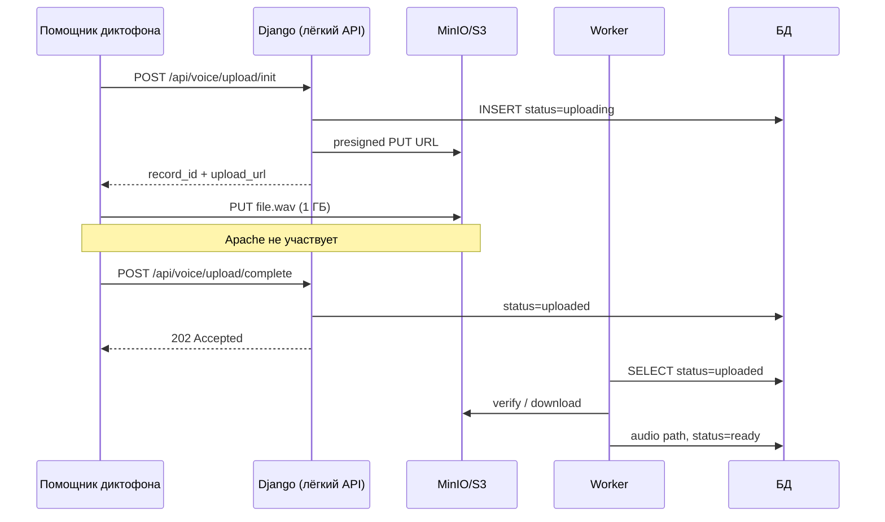

# Ежедневник КОРС

Рабочий блокнот: идеи, планы, задачи по порталу и инфраструктуре.

---

## 1. Оптимизация загрузки записей диктофона

**Дата записи:** 18.06.2025  
**Статус:** план  
**Приоритет:** высокий  

### Проблема

На портал загружаются записи диктофона (помощник / API). Характеристики:

- размер одного файла — до **~1 ГБ**;
- загрузок много, приходят **лавинообразно** (после смены, пакетом);
- в пики **портал тормозит**, **Apache сильно нагружается**.

**Окружение:** Windows + Apache + Django (mod_wsgi).

**Текущий поток:**

- Endpoint: `POST /api/post_recordeds_voice_audio_portative_programm/`
- Также загрузка через веб: `website.views.voice_recorders`
- Модель: `Records_voice_recorder`, поле `audio` → `media/records_voice_recorder/%Y/%m/%d/`
- Файл принимается **синхронно** в воркере Apache: multipart → Django → `save()` → диск + БД

**Критичная настройка в `settings.py`:**

```python
DATA_UPLOAD_MAX_MEMORY_SIZE = None
FILE_UPLOAD_MAX_MEMORY_SIZE = 262144000000  # ~250 ГБ
```

При таких лимитах Django может держать большие файлы **в RAM процесса Python**, а не сразу сбрасывать на диск. При 10–20 параллельных загрузках по 500 МБ–1 ГБ воркеры забиваются памятью и блокируются на минуты — через них же идут обычные страницы портала.

**Что именно грузит Apache:**

| Ресурс | Причина |
|--------|---------|
| RAM | большой `FILE_UPLOAD_MAX_MEMORY_SIZE` → файл в памяти воркера |
| CPU | multipart, Django ORM, возможная конвертация в том же процессе |
| Диск | запись `FileField` + temp на том же диске, что приложение |
| Воркеры | 1 upload ≈ 1 занятый воркер на время передачи 1 ГБ |
| БД | синхронный `save()` на каждый файл |

Связанные API (уже есть):

- `post_recordeds_voice_audio_portative_programm` — основная загрузка с помощника
- `get_recordeds_voice_audio_convert` / `post_recordeds_voice_audio_convert` — конвертация
- `Records_voice_recorder_queue` — очередь распознавания (паттерн очереди уже есть)

---

### Варианты решений (от лёгких к тяжёлым)

Оценка выигрыша — для **отзывчивости портала в момент лавины**, не для скорости самой загрузки.

| # | Решение | Сложность | Выигрыш для портала | Комментарий |
|---|---------|-----------|---------------------|-------------|
| 1 | Понизить `FILE_UPLOAD_MAX_MEMORY_SIZE` до 2–10 МБ | Очень низкая | 15–25% | Файл уходит во temp на диске, не в RAM. Воркер всё равно занят, но меньше OOM |
| 2 | Отдельный Apache vhost / `WSGIDaemonProcess` только для upload API | Низкая | 40–60% | Загрузки не делят воркеры с UI |
| 3 | Очередь и лимит параллелизма в помощнике диктофона | Низкая | 30–50% | 1–2 upload одновременно, backoff, ночная выгрузка |
| 4 | Rate limit + таймауты на upload endpoints | Низкая | 20–40% | Защита от перегруза |
| 5 | Upload → быстрый ответ → фоновая обработка | Средняя | 50–70% | API принимает метаданные, тяжёлое — Windows Service |
| 6 | Chunked upload (куски 5–20 МБ, resume) | Средняя | 40–60% | Короче удержание воркера, меньше обрывов |
| 7 | Отдельный лёгкий upload-сервис (другой порт) | Средняя | 70–85% | Только приём на диск/SMB; Django — очередь |
| 8 | Object storage (MinIO/S3) + presigned URL | Высокая | 75–90% | Клиент грузит напрямую в storage, минуя Apache |
| 9 | Полное разделение: Upload API + Worker + Portal | Очень высокая | 90–95% | Портал изолирован от лавины |

---

### Этап 1 — быстрые меры (1–2 дня)

**A. Память Django**

```python
FILE_UPLOAD_MAX_MEMORY_SIZE = 5 * 1024 * 1024   # 5 МБ
DATA_UPLOAD_MAX_MEMORY_SIZE = 5 * 1024 * 1024
```

**B. Apache — отдельный пул для upload**

```apache
# Основной портал
WSGIDaemonProcess portal_main processes=8 threads=1 maximum-requests=500

# Только upload API
WSGIDaemonProcess portal_upload processes=2 threads=1 request-timeout=3600

<Location /api/post_recordeds_voice_audio_portative_programm>
    WSGIProcessGroup portal_upload
</Location>
```

Дополнительно: `LimitRequestBody`, увеличенные `TimeOut` только на upload-location.

**C. Помощник диктофона**

- не больше **1–2** одновременных upload;
- повтор при ошибке с паузой;
- по возможности — не выгружать все записи сразу после смены.

**Ожидаемый эффект этапа 1:** ~50–60% улучшения отзывчивости портала в пике.

---

### Этап 2 — очередь и фон (2–4 недели)

**Схема «быстрый приём + фон»:**

```
Клиент → POST multipart → Upload endpoint
         ↓ (секунды)
         Сохранить файл на диск/SMB
         INSERT в БД: status=pending
         Ответ 202 Accepted + id

Windows Service / worker:
         - конвертация (convert API уже есть)
         - распознавание
         - status=ready
```

Расширить паттерн `Records_voice_recorder_queue` на этап загрузки.

**Chunked upload** (для файлов >100 МБ):

- `POST /api/voice/upload/init` → `upload_id`
- `PUT /api/voice/upload/{id}/chunk/{n}`
- `POST /api/voice/upload/{id}/complete` → склейка вне воркера Django

---

### Этап 3 — целевая архитектура: presigned URL + MinIO (1–2 месяца)

**Схема:**

```
Клиент → Django: «хочу загрузить file.wav»
Django → ответ: presigned URL + record_id
Клиент → напрямую в storage (минуя Apache)
Worker → забирает из storage, пишет в БД / MEDIA_ROOT
```

**Sequence:**



#### API контракт

**1. `POST /api/voice/upload/init/`**

Запрос:

```json
{
  "filename": "20250618143000.wav",
  "size": 1073741824,
  "sound_len": 3600,
  "date_create": "2025-06-18T14:30:00",
  "version": 2
}
```

Ответ:

```json
{
  "record_id": 123456,
  "upload_url": "https://minio.internal:9000/voice-uploads/...",
  "upload_method": "PUT",
  "upload_headers": { "Content-Type": "audio/wav" },
  "expires_in": 3600,
  "storage_key": "incoming/2025/06/18/uuid.wav"
}
```

**2. Клиент → Storage:** `PUT {upload_url}` с телом файла.

**3. `POST /api/voice/upload/complete/`**

```json
{ "record_id": 123456, "etag": "optional" }
```

Ответ: `202 Accepted`. Django не копирует файл — это делает worker.

#### Изменения в модели `Records_voice_recorder`

Добавить поля:

```python
# upload_status: uploading | uploaded | processing | ready | error
storage_key     # путь в bucket
storage_bucket
upload_size
upload_error
uploaded_at
```

Старые записи: `upload_status='ready'`, без миграции файлов.

#### MinIO на Windows

- Bucket: `voice-uploads`
  - `incoming/` — presigned upload (TTL 1–24 ч)
  - `archive/` — после worker (опционально)
- Отдельный диск / VM, антивирус исключить data-path MinIO
- Settings: `VOICE_UPLOAD_STORAGE` (endpoint, keys, bucket, presign TTL)
- Presigned PUT через `boto3` + `endpoint_url`

#### Worker (Windows Service)

1. Выбрать `status=uploaded`
2. `HEAD` в MinIO — размер OK?
3. **Вариант A:** скачать в `MEDIA_ROOT/records_voice_recorder/...` (минимум правок UI)
4. **Вариант B:** оставить в MinIO, в БД key/URL (нужен presigned GET для прослушки)
5. `status=ready`, запуск convert/recognition
6. Очистка: `uploading` без `complete` старше 24 ч → delete

#### Помощник диктофона — новый поток

```
1. POST init        → record_id + upload_url
2. PUT upload_url   → файл (progress, retry)
3. POST complete    → 202
```

Старый `post_recordeds_voice_audio_portative_programm` оставить на переходный период; флаг `use_presigned_upload` в конфиге помощника.

**Ожидаемый эффект этапа 3:** разгрузка Apache/Django в лавине **~85–95%**.

---

### Дополнительно (Windows + Apache)

- **Мониторинг:** busy workers Apache, RAM `httpd`, очередь upload, `% Disk Time`
- **Диск:** upload на отдельный том (не системный, не БД)
- **Антивирус:** исключить `media/records_voice_recorder/` и MinIO data
- **Celery на Windows** — слабый вариант; лучше **Windows Service** + таблица очереди (как для recognition)

---

### Рекомендуемый порядок внедрения

| Этап | Срок | Действия |
|------|------|----------|
| 0 | 1–2 дня | Этап 1: memory limit, отдельный Apache pool, лимит в клиенте |
| 1 | 3–5 дней | MinIO, bucket, ключи; поля в модели; миграция |
| 2 | 1 неделя | API `init` / `complete`; worker → `MEDIA_ROOT` |
| 3 | 1 неделя | Новая версия помощника с presigned |
| 4 | параллель | Deprecate старый multipart endpoint |

**Решения перед разработкой этапа 3:**

- [ ] MinIO: отдельный хост или на том же сервере (отдельный диск)
- [ ] После worker: **вариант A** (копия в `MEDIA_ROOT`) или **B** (только storage)
- [ ] Внутренний DNS/HTTPS для presigned URL (доступен с рабочих мест помощника)

---

### Связанные файлы в репозитории

| Файл | Назначение |
|------|------------|
| `portal/apps/api/views.py` | `post_recordeds_voice_audio_portative_programm`, convert API |
| `portal/apps/api/urls.py` | маршруты upload API |
| `portal/apps/recognition/models.py` | `Records_voice_recorder` |
| `portal/apps/website/views.py` | `voice_recorders` (веб-загрузка) |
| `portal/settings.py` | `FILE_UPLOAD_MAX_MEMORY_SIZE`, `MEDIA_ROOT` |
| `portal/templates/website/voice_recorders.html` | UI загрузки |

---

*Следующие пункты ежедневника добавлять ниже.*

## 2. …

*(пусто)*
